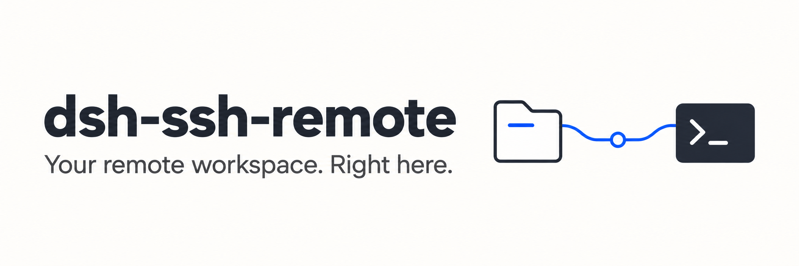
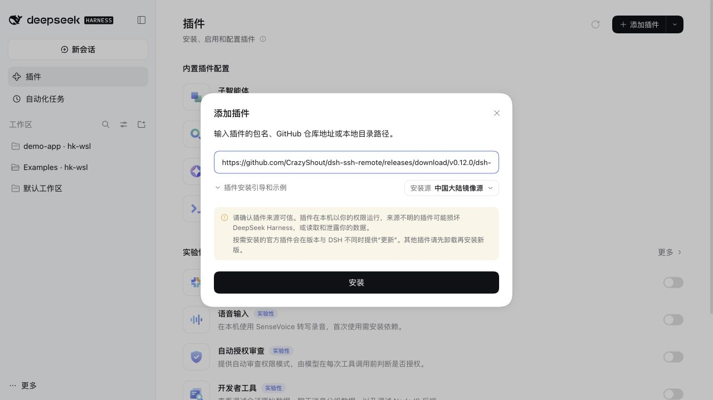
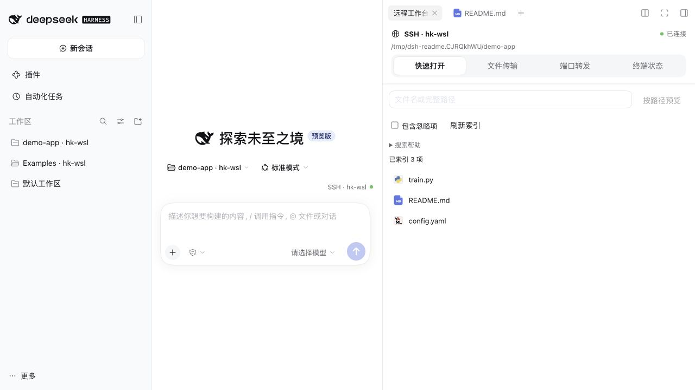

[中文](README.md) · [Download 0.12.0](https://github.com/CrazyShout/dsh-ssh-remote/releases/tag/v0.12.0) · [Changelog](CHANGELOG.md) · [Troubleshooting](docs/TROUBLESHOOTING.md)

Open an SSH workspace inside DeepSeek Harness. Browse files and run commands in its native panels, with remote editing, `@` references, port forwarding and file transfers. Reuse `~/.ssh/config`; no full DSH installation is needed on the server.

## Install: copy, install, connect

Already have working **DSH** and an **SSH alias**? Start here. Desktop includes its runtime; you do not need to install Node separately.

### Desktop / Web

1. Open **Plugins → Add plugin** in the sidebar and paste the full address below.
2. Choose **Install → Enable now**. Save your work and fully restart DSH after the first install or an upgrade from 0.11.x; follow the reported outcome for later updates.
3. Choose **Add workspace**, select your SSH host and folder, then use native **Workspace files** and **New terminal**.

~~~text
https://github.com/CrazyShout/dsh-ssh-remote/releases/download/v0.12.0/dsh-ssh-remote-0.12.0.tgz
~~~

No clone, build or manual plugin-directory copying. The installer still downloads runtime dependencies.

> **Use the full address.** The npm package named `dsh-ssh-remote` belongs to another project. Desktop and Web have separate profiles and need separate installation.

### CLI / Web: one install command

~~~sh
dsh plugin --profile web add 'https://github.com/CrazyShout/dsh-ssh-remote/releases/download/v0.12.0/dsh-ssh-remote-0.12.0.tgz'
~~~

Restart `dsh web` afterwards; stop an existing server with Ctrl-C in its terminal first. **For Desktop, use the application's own Plugins page.**

Alternative sources and the install dialog

Fixed Git tag (requires local Git):

~~~sh
dsh plugin --profile web add 'github:CrazyShout/dsh-ssh-remote#v0.12.0'
~~~

You can also download the release `.tgz` and enter its absolute path in Plugins. Verify downloads with `SHA256SUMS`. Review dependency-script prompts in the official installer, without globally allowing unknown scripts. Version 0.11.0 removed the `ssh2` / `cpu-features` native-build dependencies.

## Your everyday workflow

| Task | Entry point |
| --- | --- |
| Browse and preview files | Native **Workspace files / 工作区文件** |
| Edit and save text | File-tab menu **编辑远程文本**, or **编辑** in quick open |
| Find and reference code | **SSH · host → 快速打开**, or native `@` |
| Run commands | Native **New terminal / 新建终端** |
| See cwd, exit status and context | Terminal-tab menu **查看 SSH 终端状态** |
| Access TensorBoard, Jupyter or a dev website | **远程工作台 → 端口转发** |
| Upload/download files and folders | **远程工作台 → 文件传输** |
| Use remote skills | Native `/` skill menu in a remote Session |

The **SSH · host** badge opens the unified workbench; blank Sessions show it above the composer. Local Sessions retain their original file and terminal behavior.

Connection dots: green = SSH/helper connected; amber = connecting or limited; hollow gray = disconnected or unknown; red = connection error. Hover or keyboard-focus for the full path and explanation. Green does not certify every remote feature.

## New to SSH?

Install DSH using the [official instructions](https://github.com/deepseek-ai/deepseek-harness), then configure a concrete local OpenSSH alias:

~~~sshconfig
Host devbox
  HostName your-server.example.com
  User your-user
~~~

Run `ssh devbox`, verify the host fingerprint on first login, then `exit`. The plugin uses non-interactive authentication, so also check:

~~~sh
ssh -o BatchMode=yes devbox true
~~~

Follow the three installation steps above and run `pwd` in a native terminal to verify the remote directory. No model message is needed. The first connection deploys the matching Python helper; host diagnostics are in **Settings → Built-in plugins → SSH Remote**. Keep custom `Port`, `IdentityFile` and `ProxyJump` settings in OpenSSH, without duplicating them in the plugin.

## Requirements and limits

Validated DSH versions: **0.2.0-rc.2 / 0.2.1-rc.2**. Check each Release for other compatibility results.

| Purpose | Requirement |
| --- | --- |
| Desktop | Official DSH Desktop, with its bundled Node and package manager |
| CLI / Web | Node 22+, `dsh` and `pnpm` on PATH |
| Basic remote connection | Local OpenSSH and non-interactive authentication; remote Python 3.8+ |
| Search and `@` completion | Remote ripgrep; Git workspace discovery also needs Git |
| Restricted model commands | Remote Linux and bubblewrap; not required for browsing or human terminals |

- Editing: complete UTF-8 files, **256 KiB** maximum. Save drafts before restarting.
- Transfers: **1 TiB per file/batch**; small real samples and simulated boundaries tested, not TB-scale throughput. Restart recovery requires source/destination reauthorization.
- Forwarding: currently validated on macOS / Linux hosts. Windows has no full Desktop/SSH acceptance.
- Skills: project and user `.dsh/skills` / `.agents/skills` by default, without following symlinks or automatically running scripts.
- DSH's Finder / local-application actions remain local; use preview and remote editing for SSH files.

See the [technical reference](docs/TECHNICAL.md) for detailed boundaries. Old SFTP/plugin-host configurations have a [migration guide](docs/MIGRATION-0.11.md). Existing OpenSSH aliases need no migration; upgrades never automatically rewrite SSH configuration.

## Update, roll back and remove

**In-app updates:** open **Plugins → dsh-ssh-remote → 检查更新 (Check for updates)**. Select **更新到… → 确认更新** to install a newer stable release without visiting this repository or copying another link. Automatic checks run every six hours while the page is visible; switch them off on the same page without losing manual checks. A new-version notice appears once and never starts installation by itself.

Package installation uses DSH's official service, including dependency approvals and compatibility checks. Installed and running versions are shown separately. Save drafts and pause transfers first: **reloading the SSH plugin may end its terminals and port forwards. It never automatically restarts DSH.** If a response is lost, choose **重新确认结果** to reconcile the result instead of automatically reinstalling.

Source `link:` / local-directory installs show version information only and must be synchronized with Git; archives never replace them automatically. Version 0.11.2 and earlier need one manual installation of 0.12.0 to gain this feature. [Releases](https://github.com/CrazyShout/dsh-ssh-remote/releases) remain available for manual selection. If DSH refuses to replace a source directly, follow its plugin-page guidance; this feature does not remove the old package first. Web CLI users can still repeat `add` in the same profile.

**Roll back to 0.11.2:** install the previous official release in Plugins, or run:

~~~sh
dsh plugin --profile web add 'https://github.com/CrazyShout/dsh-ssh-remote/releases/download/v0.11.2/dsh-ssh-remote-0.11.2.tgz'
~~~

Restart when requested. Version 0.11.2 was validated with both DSH baselines and shares the 0.12.0 helper; migrated OpenSSH settings remain.

**Disable / remove:** use the application's Plugins page. For Web, you can also stop the server and run:

~~~sh
dsh plugin --profile web remove dsh-ssh-remote
~~~

Removal does not delete remote projects, local conversations or SSH configuration. Remote workspaces need the plugin to work; reinstalling reuses saved mappings.

## Help and development

[Troubleshooting](docs/TROUBLESHOOTING.md) · [Report an issue](https://github.com/CrazyShout/dsh-ssh-remote/issues) · [Technical reference](docs/TECHNICAL.md) · [Roadmap](docs/ROADMAP.md) · [Release procedure](docs/RELEASING.md) · [Changelog](CHANGELOG.md)

Include plugin / DSH versions, Desktop or Web, installation source and the first actual error. Do not include credentials.

MIT License.
