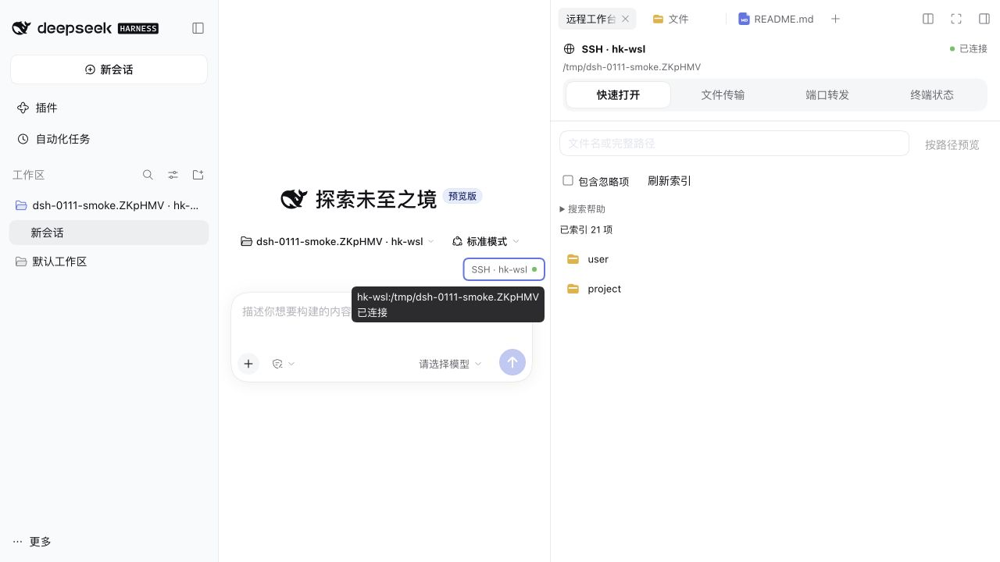

# 0.11.2 验收记录

## 代码与自动化

- 基线：插件 0.11.1 → 0.11.2；DSH 0.2.0-rc.2 / 0.2.1-rc.2，不升级 DSH。
- 本机两版 SDK 的 Host/Client 类型检查与完整回归分别 **440 通过、9 个环境条件跳过**。本机构建与测试分开执行，测试限制为一个 worker；沙箱首次禁止 `ps` 和监听端口的用例在获准的本机环境完整重跑通过，没有放宽断言。
- 新用例覆盖全部状态、共享轮询、隐藏/恢复、失败/十秒超时、最后使用者退出、会话/主机切换、连接代次变化及迟到响应。新代次重新核对工作区映射；断线时保留已验证身份，但显示未知状态。
- 功能与说明提交 `0c10e868eccedff6f025180ddf945b2869afe25f` 的 19 项 CI 通过，包含两版 DSH 的 macOS/Linux 安装矩阵、Windows 专项及 helper 回归。最终文档提交和发布检查以 [PR #31](https://github.com/CrazyShout/dsh-ssh-remote/pull/31) 的实际状态为准。

## Web / Desktop 实测

- 使用独立 profile 和既有小型 SSH 测试目录；默认 Desktop 与隔离 Desktop 并行，未退出、重启或修改默认实例配置。
- Web 与原生 Desktop 均确认入口圆点、工作台同源状态、键盘聚焦时的完整路径/文字提示，以及明暗主题、宽/窄侧栏。Web 窄栏实测 335.5 CSS px，无横向溢出；长主机名由组件回归覆盖，不为此修改 SSH 配置。
- Web 显式断开该测试 profile 的 SSH 后，两处显示灰色空心“未连接”；后续远端文件访问恢复连接后，两处恢复绿色。
- 仅停止隔离 Web Host，现有客户端两处立即显示“状态未知”，没有保留旧绿点；恢复同一测试 Host 后，原会话映射和状态重新确认。切换本地工作区后 SSH 入口消失。
- 打开工作台前后的未发送测试草稿保留，验收后已清空。官方文件树/预览读取远端标记正文；Desktop Host 的官方终端运行 `pwd`，切换工作台再返回仍是原终端，可输出第二个标记，最后 `exit` 的退出码为 0。
- Desktop Host 的文件/终端闭环通过其浏览器表面先验证；原生窗口随后单独核对状态、焦点提示和布局，不将浏览器截图充当原生 Desktop 视觉证据。没有发送模型请求，也没有重复传输故障注入或大文件测试。

## 实际包与兼容边界

- 实际候选 `.tgz` 在独立 profile 完成安装、0.11.1 升级/回退、停用、卸载与工作区数据保留；两个隔离 Web/Desktop profile 的官方插件管理器均安装/启用候选，安装后的客户端 SHA-256 与构建产物一致。
- 已验收客户端 SHA-256：`5835d888f82c8fbe4d23a7c662e8a3d61b413375f44d0bb4f3450209fefcd68a`。最终 Release 会增加本记录和截图，压缩包校验和因此以发布的 `SHA256SUMS` 为准；公开下载和安装是独立发布门槛。
- helper 保持 0.11.0，组合 SHA-256 为 `3c3b35a6a6c20703053cb06d8ee770031d92266750d7909bc41e96087f8d09be`，内容未变。Host RPC、SSH 配置、终端执行与传输格式未改动。
- 绿点表示最近确认的 SSH/helper 连接，不保证所有能力或瞬时物理断网检测。官方工作区列表保持不变；文件夹小地球及行尾状态仍等待公开扩展接口。

English: both supported SDK suites, the cross-platform CI matrix, real archive lifecycle, isolated Web connection loss/recovery and native macOS Desktop visual checks passed within the stated scope. Windows coverage is automated, not a full native Windows Desktop/SSH acceptance. No default-instance restart, model request, SSH configuration change or helper redeployment was performed. Public release download/install verification remains separate from candidate acceptance.
